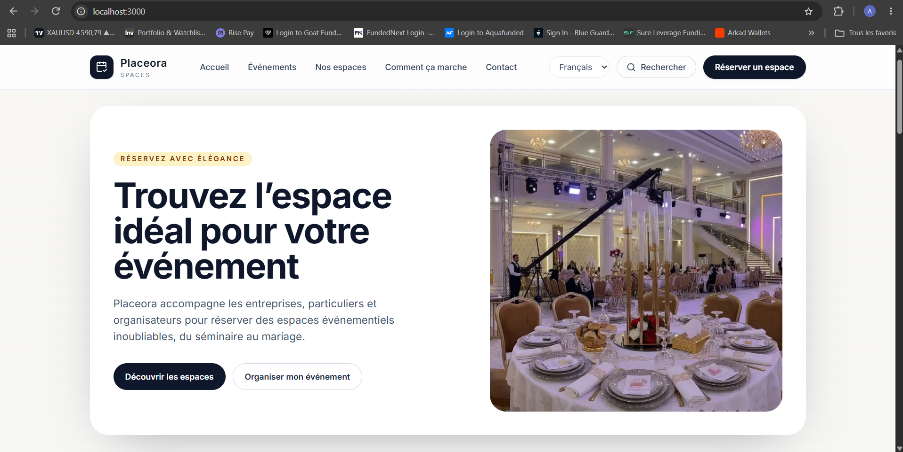
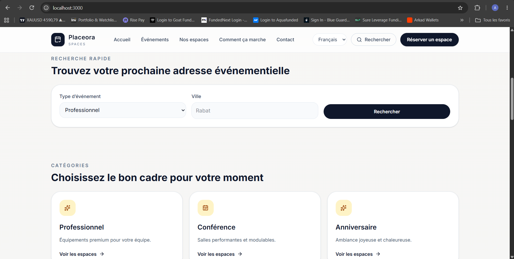
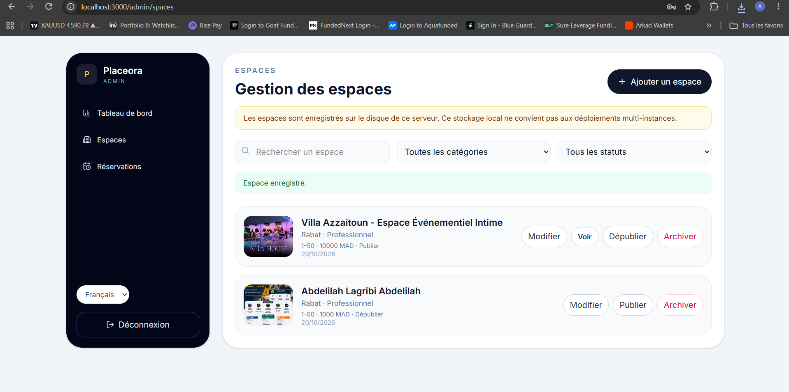
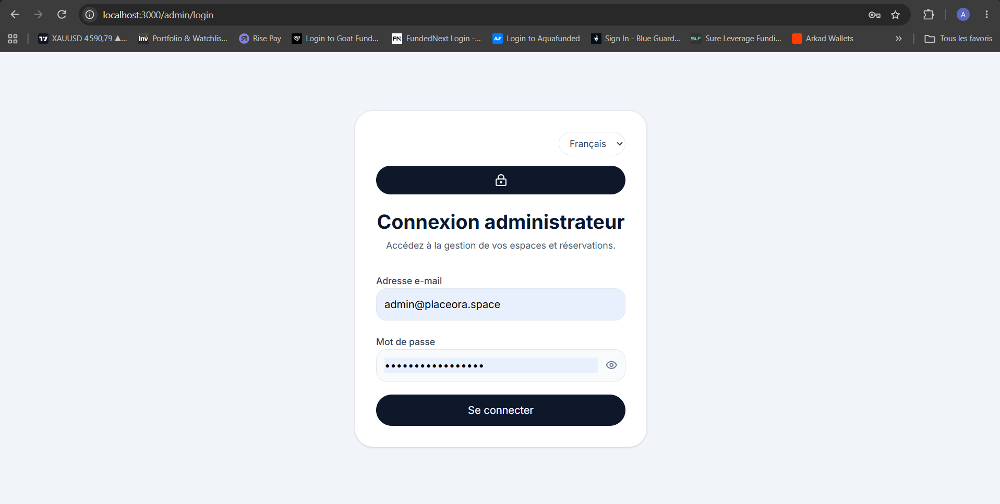
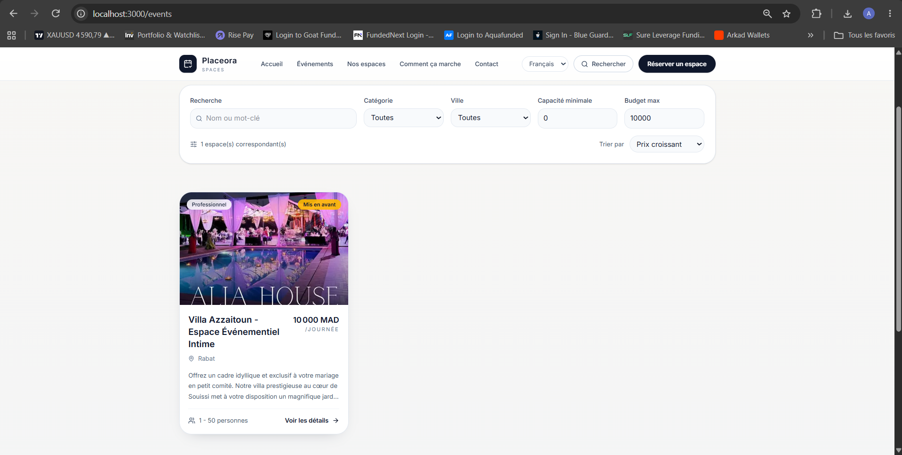

# Placeora — Event Space Rental Platform

**Discover the right venue. Plan your event. Make it happen.**

Placeora is a web platform designed to simplify the discovery and rental of event spaces in Morocco. It connects people looking for venues with space owners who want to promote and rent their properties.

Starting in Rabat and Casablanca, Placeora aims to become a trusted intermediary in the event-space rental market, helping customers find suitable venues while giving owners greater visibility and access to potential clients.

---

## Table of Contents

- [1. Project Overview](#1-project-overview)
- [2. The Problem](#2-the-problem)
- [3. The Solution](#3-the-solution)
- [4. How Placeora Works](#4-how-placeora-works)
- [5. User Roles](#5-user-roles)
- [6. Main Features](#6-main-features)
- [7. Business Model](#7-business-model)
- [8. Technology Stack](#8-technology-stack)
- [9. Project Architecture](#9-project-architecture)
- [10. Screenshots](#10-screenshots)
- [11. Installation and Setup](#11-installation-and-setup)
- [12. Security and Data Management](#12-security-and-data-management)
- [13. Roadmap](#13-roadmap)
- [14. Project Vision](#14-project-vision)
- [15. Author](#15-author)

## 1. Project Overview

Placeora is an event-space rental marketplace focused on the Moroccan market.

Finding a suitable venue for a wedding, birthday, engagement, corporate event, conference, or private celebration can be time-consuming. Information is often scattered across social media, classified advertisements, and direct contacts with venue owners.

Placeora aims to centralize this information in one platform, making it easier for customers to discover venues, review their details, and submit reservation requests.

At the same time, it gives venue owners an opportunity to showcase their spaces and reach potential customers.

**Initial target market:** Rabat and Casablanca, Morocco.

**Business approach:** Start as an intermediary connecting customers and venue owners, validate demand, and gradually develop a more complete rental marketplace.

## 2. The Problem

### For customers

- Finding suitable event spaces requires searching across multiple platforms.
- Venue information, photographs, prices, and conditions may be incomplete.
- Contacting several owners individually takes time.
- Comparing different venues can be difficult.
- Reservation requests may lack a clear follow-up process.

### For venue owners

- Reaching new customers can be difficult.
- Promoting a venue requires time and marketing effort.
- Managing inquiries through multiple channels can become complicated.
- Smaller venues may lack a dedicated website or online booking system.

## 3. The Solution

Placeora provides a centralized digital platform where customers can explore event spaces and request reservations, while administrators manage venue listings and reservation inquiries.

The platform focuses on three principles:

- **Discovery:** Present event spaces with photographs and useful information.
- **Simplicity:** Make it easy to submit a reservation request.
- **Trust:** Verify availability and reservation details before finalizing a booking.

The initial version prioritizes a practical, human-assisted reservation process rather than requiring a fully automated booking and payment system from day one.

## 4. How Placeora Works

### Customer journey

1. **Discover:** Visit Placeora and browse the available event spaces.
2. **Explore:** Open a venue's detail page to review its photographs and information.
3. **Choose:** Identify a venue that matches the event's needs.
4. **Request:** Submit a reservation request with the relevant event details.
5. **Confirmation:** The administrator follows up with the customer to verify availability and the reservation requirements.
6. **Finalize:** Agree on the reservation conditions and payment arrangements after confirmation.

A reservation request does not automatically guarantee a confirmed booking. Availability and final conditions must be verified.

### Venue management journey

1. A venue owner or intermediary provides information about a space.
2. The administrator reviews and manages the listing.
3. The space is published for customers to discover.
4. Reservation inquiries are received and followed up.
5. The administrator updates the relevant reservation information.

### Administrative workflow

The administration interface centralizes the management of venue listings and customer reservation requests.

Administrators can manage spaces, review incoming requests, and maintain the information displayed on the platform.

## 5. User Roles

| Role | Responsibilities |
|---|---|
| Customer | Browse spaces, review venue information, and submit reservation requests. |
| Venue owner | Provide venue information and make the space available for promotion and rental through the platform. |
| Administrator | Manage listings, monitor reservation requests, and coordinate confirmation with customers. |

The initial MVP uses an administrator-assisted process. Dedicated venue-owner accounts and a self-service owner dashboard can be introduced in a later version.

## 6. Main Features

### Public website

- Home page introducing the platform.
- Event-space discovery and listing pages.
- Individual space detail pages.
- Venue photographs and descriptive information.
- Reservation request form.
- Reservation success page.
- Responsive web interface.

### Reservation management

- Collection of customer and event information.
- Centralized reservation requests.
- Administrative follow-up and manual confirmation.
- Reservation request management through the administration interface.

### Administration

- Administrator login.
- Dashboard for managing platform activity.
- Space creation, editing, and deletion.
- Space image upload and management.
- Reservation request management.

### Multilingual interface

Placeora is designed to support:

- French
- English
- Arabic

Arabic support is particularly relevant to the Moroccan market, alongside French and English.

### Image management

Venue photographs are managed through Cloudinary, a cloud-based media management service. This avoids storing large image files directly in the application directory.

## 7. Business Model

Placeora is designed to begin with an intermediary-based business model.

### Initial model: Commission on rentals

The platform connects customers with venue owners and helps coordinate reservations. Revenue can be generated through a commission on completed rentals, subject to agreed terms with venue owners.

### Potential future revenue streams

- Commission on confirmed bookings.
- Premium venue listings.
- Paid promotional placement for venue owners.
- Additional services for event organizers.
- Partnerships with complementary event-service providers.

### Go-to-market strategy

The initial strategy is to build a curated catalogue of event spaces in Rabat and Casablanca.

The first steps are to identify venue owners, collect accurate venue information and photographs, publish listings, attract potential customers, and manually coordinate reservation requests.

This approach helps validate customer demand and venue-owner interest before investing in more complex automation.

## 8. Technology Stack

The project uses a modern JavaScript and TypeScript web development stack.

| Technology | Purpose |
|---|---|
| Next.js | Web application framework and application routing |
| React | User interface development |
| TypeScript | Type-safe application code |
| CSS and UI components | Styling and interface layout |
| Cloudinary | Cloud-based image storage and delivery |
| npm | Dependency and package management |

The precise implementation of individual modules may evolve as the platform develops.

## 9. Project Architecture

The repository is organized around the Next.js application structure.

```text
placeora/
├── app/                 # Application pages and API routes
├── components/          # Reusable UI components
├── images/              # Screenshots used in this README
├── lib/                 # Shared utilities and application logic
├── public/              # Public static assets
├── .placeora-data/      # Local application data (not committed)
├── .env.local           # Local environment variables (not committed)
├── .gitignore
├── package.json
├── package-lock.json
└── README.md
```

The exact structure may change as features are added.

### Application and media storage

Placeora separates application information from image files:

- **Application data:** Space and reservation information is handled by the application's configured data-storage mechanism.
- **Media files:** Venue images are uploaded to Cloudinary.
- **Configuration:** Environment variables are used for local and deployment-specific settings.

If local disk storage is used for application data, that approach must be evaluated before scaling to multiple application instances. A persistent database or another shared storage solution is a future production-hardening priority.

## 10. Screenshots

The following screenshots illustrate the Placeora interface and administration features.

### Home Page

The home page introduces Placeora and helps visitors discover the platform.



*Placeora home page.*



*Alternative view of the home page.*

### Browse Event Spaces

The spaces listing page allows customers to explore event venues.



*Event-space discovery interface.*

### Space Details

The detail page presents information and photographs about an individual venue.


*Individual event-space details.*

### Administration Interface

The administration interface supports the management of the platform.

#### Administrator Login



*Administrator authentication interface.*

#### Admin Dashboard


*Administration dashboard.*

#### Space Display and Management



*Space display and management interface.*

## 11. Installation and Setup

### Prerequisites

- Node.js compatible with the project's Next.js version.
- npm.
- A Cloudinary account if image upload functionality is required.
- The environment variables required by the application.

### Step 1 — Clone the repository

```bash
git clone https://github.com/Abdelilah-Lag/placeora.git
cd placeora
```

### Step 2 — Install dependencies

```bash
npm install
```

### Step 3 — Configure environment variables

Create a `.env.local` file in the project root and configure the variables required by the application.

Use the variable names expected by the source code and deployment configuration. Never commit credentials, API secrets, passwords, or other sensitive configuration.

### Step 4 — Start the development server

```bash
npm run dev
```

Open [http://localhost:3000](http://localhost:3000) in your browser.

If port 3000 is already occupied, Next.js may use another available port.

### Step 5 — Create a production build

```bash
npm run build
```

To run the production application locally after building:

```bash
npm run start
```

Check `package.json` for the exact scripts configured in the repository.

## 12. Security and Data Management

Security and reliable data handling are important for a platform that processes customer contact details and reservation requests.

- Never commit `.env.local` or other files containing secrets.
- Keep `.placeora-data/` out of version control if it contains local application data.
- Keep `node_modules/`, `.next/`, and build artifacts out of the repository.
- Restrict administrative access to authorized users.
- Validate reservation form input on the server.
- Protect administrative API routes and sensitive operations.
- Avoid exposing private customer information in public pages or logs.
- Back up important reservation and venue data.
- Use persistent shared storage for production deployments where required.

Cloudinary stores image assets; it does not automatically replace a database for venue information or reservations.

**Payment status:** The initial workflow is based on reservation requests and manual confirmation. Do not assume that an online card-payment gateway is integrated unless it has been implemented and configured.

## 13. Roadmap

The following items represent potential improvements, not a claim that they are already implemented.

### Phase 1 — MVP

- [x] Develop the initial web application.
- [x] Create the main pages for browsing and viewing event spaces.
- [x] Build the initial reservation-request workflow.
- [x] Develop an administration interface.
- [x] Integrate Cloudinary for venue images.
- [x] Prepare a multilingual interface.

### Phase 2 — Operational Reliability

- [ ] Move application data to a persistent, shared database.
- [ ] Improve reservation validation and status tracking.
- [ ] Strengthen authentication and administrative authorization.
- [ ] Add reliable backups, logging, and error handling.
- [ ] Improve mobile usability and accessibility.

### Phase 3 — Marketplace Development

- [ ] Introduce dedicated venue-owner accounts.
- [ ] Allow owners to manage their own listings.
- [ ] Improve availability management and prevent booking conflicts.
- [ ] Add customer notifications and reservation tracking.
- [ ] Introduce a more structured commission and reconciliation process.

### Phase 4 — Growth

- [ ] Expand to additional Moroccan cities.
- [ ] Add advanced search and filtering.
- [ ] Evaluate secure online payments through a suitable payment provider.
- [ ] Add reviews and ratings where appropriate.
- [ ] Build partnerships with event planners and service providers.
- [ ] Explore analytics and tools for venue owners.

## 14. Project Vision

The long-term vision for Placeora is to become a trusted marketplace for discovering and renting event spaces across Morocco.

The project starts with a focused MVP and a human-assisted operating model. As the number of venue owners, customers, and reservation requests grows, the platform can progressively introduce automation, dedicated owner accounts, improved availability management, and secure online payments.

The goal is to make event-space discovery more accessible for customers while helping venue owners improve their visibility and reach new business opportunities.

## 15. Author

**Abdelilah Lagribi**

- GitHub: [@abdelilah-30](https://github.com/abdelilah-30)
- Portfolio: [View portfolio](https://portfolio-abdelilah-lagribi--abdelilahlagrib.replit.app/)

---

*Placeora is an evolving project. Features described as future improvements are part of the proposed roadmap and may not be available in the current version.*
